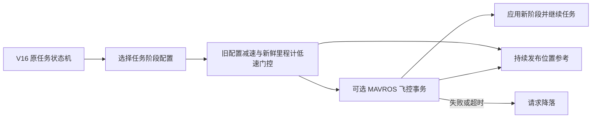

# CUADC GUIDED 阶段配置切换方案草案

这是根据你提供的 GUIDED 在线调参说明，为 [Accelerate11/2026CUADC](https://github.com/Accelerate11/2026CUADC) 制作的**完整状态机工作空间提案**。目录沿用“留给后人的话”中的提案形式：说明方案、交付源码、给出运行入口，并单独记录验证结果和边界。

本版以公开 V16 完整工作空间为基线，新增巡航、搜索、接近、视觉对准、投放、侦察、返航的阶段配置，以及不阻塞 setpoint 发布的切换门控。优先在 NUC 侧调整参考运动和视觉修正力度；飞控改速与 PID 参数事务是默认关闭的可选实验入口。没有使用臆造的满载、单瓶、空载 PID 数值。

## 先查看和验证

从本目录进入 `ws_offboard_guided_profiles/`，其中 `src/` 是实际 ROS 2 源码，不依赖另一个 V16 目录。目标环境是 Ubuntu 22.04、ROS 2 Humble、C++17；依赖准备见 [工作空间环境说明](ws_offboard_guided_profiles/environment/README.md)。

```bash
cd ws_offboard_guided_profiles
python3 scripts/validate_source.py
bash scripts/build_onboard.sh
bash scripts/verify.sh
```

上述命令校验、编译和执行离线回归，不启动飞控、相机或任务。仅作源码检查时使用 `bash scripts/verify.sh --source-only`，其中视觉测试仍需要 NumPy 和 OpenCV。在 Windows 也可以从工作空间根目录执行 `python scripts/validate_source.py`；完整 ROS 构建使用目标 Linux 环境。

**本提案的任务配置默认 `flight_enable: false`、`auto_arm_on_guided: false`，可选飞控配置写入也关闭。**飞行与舵机相关入口仍具有硬件执行能力；默认值不能替代现场适配。[接入与实验计划](docs/03_接入与实验计划.md) 给出逐步启用流程。

## 本版具体实现



| 内容 | 本版处理 |
| --- | --- |
| 上位机阶段配置 | 七组水平/垂直速度、参考加速度、视觉修正增益 |
| 平滑切换 | 按旧配置减速，等待实际低速持续稳定，再切新配置 |
| 飞控改速 | 可选异步 `MAV_CMD_DO_CHANGE_SPEED`；默认关闭 |
| 飞控 PID 参数组 | 可选白名单、拉取快照、逐项写入、回值检查、失败处理；默认关闭，参数组为空 |
| 载荷阶段 | `full / single / empty` 标签来自原投放流程计数，不是重量或瓶体脱离检测 |
| Lua | 保留为后续方案，未交付飞控 Lua 实现 |

原任务 `State` 枚举和主要流程保留：准备 → GUIDED → 起飞 → 搜索 → 两次投放 → 侦察 → 返航 → 降落。阶段切换是独立门控，等待时不推进阶段逻辑；恢复后航段从停稳参考位置重建，总任务与投放阶段总预算继续运行。

实际输出沿用 `/mavros/setpoint_position/local` 的 `PoseStamped`。本地速度与加速度设置约束**发送的位置参考轨迹**，不代表改写飞控 PID，也不能直接保证机体真实速度、加速度。原 V16 的视觉、模型、坐标标定、舵机、投放回退和复盘工具一并保留。

原 V16 分段投放规则在 4–6 秒放宽观测条件、到 6 秒可强制投放，并保留投放阶段超时后的固定坐标回退。本提案没有将这些规则改成新的安全证明；实际采用前应一并审查原任务策略。

## 阅读顺序

1. [方案设计](docs/01_方案设计.md)：状态、切换流程和故障处理。
2. [参数与接口](docs/02_参数与接口.md)：七组默认值、服务类型、单位和配置例子。
3. [接入与实验计划](docs/03_接入与实验计划.md)：从离线到同版本 SITL 再到实机。
4. [验证记录](docs/04_验证记录.md)：本次实际执行结果及未覆盖内容。
5. [来源与边界](docs/05_来源与边界.md)：基线提交、官方依据、许可与适用限制。

## 文件夹结构

```text
提案4_GUIDED阶段配置切换/
├── README.md
├── 项目草案说明.txt
├── docs/                              # 设计、参数、接入、验证、来源
├── scripts/package_proposal.py        # 重新打包提案，排除编译和运行产物
└── ws_offboard_guided_profiles/        # 可独立编译的完整 ROS 2 工作空间
    ├── src/cuadc_full_mission_20260803/
    │   ├── src/                       # 原任务状态机及阶段/事务逻辑
    │   ├── config/                    # 默认关闭实飞的任务配置
    │   ├── scripts/                   # 原视觉、记录、时间同步工具
    │   ├── models/                    # 原 ONNX、PT、OpenVINO 权重
    │   └── test/                      # 原回归与新增切换回归
    ├── full_mission/、drop_only/        # 完整任务与仅投放入口
    ├── routes/、tools/、environment/   # 标定、部署和环境资料
    ├── scripts/                       # 构建、校验、离线测试
    ├── BASELINE_SOURCE.json            # 公开 V16 来源清单
    └── LICENSE、LICENSES.md            # 原 AGPL 与第三方许可
```

如需重新打包，在**本提案根目录**执行 `python3 scripts/package_proposal.py`，生成同级 ZIP；这与进入工作空间后执行的编译、验证命令不同。

这是可审查、可编译和可做离线回归的提案版本，**未经过本次实飞验证**。工作空间内原 V16 历史验证记录不能作为新增阶段切换的飞行证据；以本提案 [验证记录](docs/04_验证记录.md) 为准。当前没有给出实机 ArduCopter 完整版本和原机飞控参数导出，Copter 4.5 仅用于解释原说明的实现差异。
