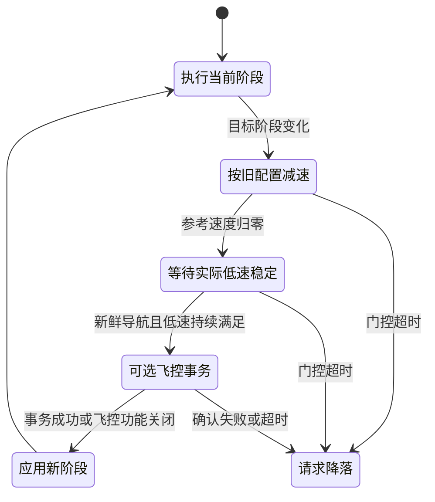

# 01 · GUIDED 阶段配置切换设计

## 目标与分层

让同一套任务状态机在巡航时采用较快参考轨迹，接近目标时减速，在视觉对准、投放时限制修正，并在阶段切换时处理确认、超时和失败。第一版以 NUC 上的参考轨迹配置为主，飞控保持既有已验证内环。只有载荷实验确实需要不同飞控增益时，才启用可选参数事务。

这是三个独立层次：

| 层次 | 设置什么 | 成功意味着什么 |
| --- | --- | --- |
| 本地参考层 | 位置参考的速度、参考加速度、视觉增量倍率 | 软件已采用新配置 |
| 飞控接口层 | 改速命令、白名单内的 PID 参数值 | MAVROS 收到符合检查的回应 |
| 飞行验证层 | 飞控日志和飞机运动 | 在指定载荷、工况下响应达到验收标准 |

前两层通过，不能替代第三层。GUIDED 内部仍有不同控制路径，实机 `GUID_OPTIONS`、setpoint 种类及固件源码共同决定接口效果。官方说明列出了位置目标使用航点导航的 bit 6 配置。[ArduPilot GUIDED 说明](https://ardupilot.org/copter/docs/ac2_guidedmode.html)

## 原任务状态与新增阶段

保留 V16 的 `State`：`WAIT_FCU / WAIT_GUIDED / LOCK_FRAME / PRESTREAM / WAIT_ARM / TAKEOFF / SEARCH / ALIGN / RELEASE / RECON_CLIMB / RECON_SURVEY / RETURN_CLIMB / RETURN_HOME / LAND / DISARM / DONE / PILOT_OVERRIDE / ABORT`。新增阶段配置不替换这些任务状态。

`cruise / search / approach / align / release / recon / return` 是运动策略阶段，映射如下。配置数值见 [参数表](02_参数与接口.md)，起飞、降落、舵机和任务退出继续由原状态机负责。

| 原任务分支 | 运动阶段 |
| --- | --- |
| `WAIT_ARM`、首段进入搜索区、`RECON_CLIMB` | `cruise` |
| 首段进场完成后的搜索横扫 | `search` |
| `ALIGN` 中桶间转场或固定投放点转场分支 | `approach` |
| `ALIGN` 其余末端对准分支 | `align` |
| `RELEASE` | `release` |
| `RECON_SURVEY`，含前往侦察首航点的转场 | `recon` |
| `RETURN_CLIMB / RETURN_HOME` | `return` |

## 切换门控

1. 保存切换目标，冻结任务阶段推进；按旧阶段加速度限制将参考运动降至零。避免瞬间把高速参考改成低速参考。
2. 继续发布原位置 setpoint。等待里程计新鲜，实际水平、垂直速度低于门槛，并连续保持 `guided_switch_stable_s`。
3. 飞控功能关闭时直接完成本地切换；开启时启动异步事务，setpoint 定时器继续运行。
4. 确认成功后应用新阶段，恢复阶段逻辑；有导航航段时从停稳参考位置重建起点，保留原任务终点，按新阶段速度上限重算标称航段时间，并让目标同步到当前保持参考后继续任务。`WAIT_ARM`、末端 `align / release` 不重建航段。超时或失败进入原降落处理。

默认总切换预算为 20 秒，导航最大年龄 0.3 秒，稳定持续 0.5 秒，实际水平/垂直速度分别不高于 0.25/0.15 m/s。失效导航不算稳定。等待时不推进阶段逻辑，恢复后导航航段从停稳参考位置重建，总任务和投放阶段总预算按实际经过时间运行，避免反复切换无限延长任务。门控期间若任务看门狗改写了目标阶段，飞控事务尚未开始时重新启动对应门控；事务已经开始时取消后续请求并进入降落，不继续应用已失效的阶段。

本地航段完成同时要求参考低速、实际低速和不超过 0.3 秒年龄的新鲜导航，不能仅用原航段定时到期判断已飞完。新增平滑参考可能延长转场，所以应重新核对全任务预算，不把原航段时长当作本版实际飞行时间。

本地约束作用于位置参考的运动历史；机体仍可能存在跟踪误差、飞控内部限幅、风扰或低频导航估计。因而使用实际里程计稳定门控，并在实验中同时记录参考和实际运动，而非仅观察配置日志。

## 可选飞控事务

改速使用 `CommandLong` 命令 178；增益组仅允许已核对的 `ATC_RAT_{RLL,PIT,YAW}_{P,I,D}` 浮点参数。没有任意参数透传，也不包含机架、EKF、传感器、重启参数或导航参数批量写入。

参数事务先强制拉取飞控参数，再从 MAVROS 本地缓存取得此次需要写入的原值。快照完整、类型有效且范围检查通过后，逐项发送；每一项都检查服务成功、返回类型和浮点回值，再进行下一项。普通参数协议没有整组原子提交，本版不能保证三个增益在同一控制周期更新。[MAVLink 参数协议](https://mavlink.io/en/services/parameter.html)

收到 `ParamSetV2 success=true` 但回值不符时，可以有限重试，耗尽后逐项恢复本次可能触及的参数；恢复成功仍视为本次阶段失败，任务不继续。`success=false` 没有失败原因字段，可能意味着 MAVROS 内部 ACK 等待超时；客户端自身超时、该响应、取消均按结果未知处理，停止追加写入并锁存失败。未知结果下可能仍有请求在飞控端执行，不能并发发送反向恢复并认定已回滚；交由降落及落地复核。人工接管时停止本节点后续事务，已经发送的 MAVLink 不能从链路中撤回。

这是操作层面的故障处理，不能消除临时混合增益、积分历史和控制器运行值未知的风险。启用前必须验证完整参数组及中间组合，不以插值代替稳定性试验。写入飞控参数还可能保存到非易失存储，需要留存飞前导出并在落地后复核。

## 载荷标签和投放边界

`full` 对应尚未完成第一瓶投放流程，`single` 对应原流程计数已推进一瓶，`empty` 对应两瓶流程完成。流程使用原 `payload_index_`，与舵机动作确认和收回流程联动；没有新增重量、脱离或落桶传感器。因此不能将这些标签直接视为物理载荷真值，当前也没有自动选择三套 PID 增益。

保留原视觉锁定、坐标转换、舵机执行与投放判据。原分段投放允许 4–6 秒单帧触发、6 秒超时强投，另有投放阶段超时固定坐标回退。进入、完成阶段门控时清空尚未提交投放命令的分段计时与观测累计，恢复后按实际高度和新鲜视觉重新开始 0.5/4/6 秒窗口，不能把等参数的时间算成稳定投放时间。已经提交的舵机 ACK/保持/收回期限继续由原流程处理，不在动作中途启动阶段事务。新增门控不能把原投放逻辑解释为持续满足所有稳定条件才投放。

## 观察点

日志 `GUIDED_STAGE_SWITCH_BEGIN`、`GUIDED_STAGE_APPLIED` 和 `GUIDED_STAGE_GATE_TIMEOUT` 用于核对切换开始、完成与超时，`[GUIDED_PROFILE]` 打印飞控事务的可读状态。记录阶段、载荷标签、事务结果，并将日志与 setpoint、里程计和飞控 DataFlash 同步分析。`APPLIED` 仅表示软件/接口层完成，实际响应按 [实验计划](03_接入与实验计划.md) 判定。
