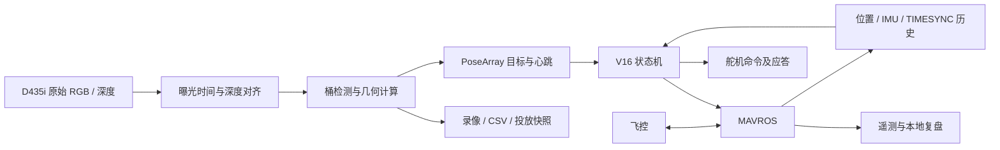

> 历史基线文档：下文记录原公开 V16 的设计、配置或验证结果。本提案新增阶段配置切换，并将默认飞行开关关闭；当前说明以工作区 README 和上级提案 docs 为准。原 V16 的测试结果不表示本提案已经实飞验收。

# V16 系统与算法说明

整体方案沿用 ArduPilot、ROS 2、MAVROS、NUC 和下视 D435i。任务控制保留在原 C++ 节点，视觉处理保留在原 Python 文件。此次整理保持原包边界，便于将公开源码与原飞机代码逐文件对应。

## 数据流

## 时间与坐标

完整任务和仅投放配置开启 `measurement_time_sync`。视觉先读取原始彩色和深度帧的曝光时间，再做深度对齐和推理。飞控位置按 odom 测量时间建立历史，姿态按 IMU 测量时间独立建立历史，两者分别插值到图像曝光时刻。接收时间只用于判断通信是否持续。

场地航向由本轮两点 GPS 标定决定，影响搜索、侦察和返航路线。视觉中的机体坐标变换使用对应时刻的实际姿态。V16 保存旧帧观测位姿，最终对准时先投影到世界坐标，再结合飞机当前位姿计算剩余误差。原实现见 `src/cuadc_full_mission_20260803/src/cuadc_full_mission_node.cpp` 与 `scripts/capture_clock.py`。

## 搜索与选择

V16 实际搜索路线固定为两条横扫、四个航点；`search_lane_count: 3` 是原配置残留值，此版本不会据此生成三条航线。搜索位置使用最近 15 个样本的中位数。完整任务配置要求目标累计至少 6 个不同帧、位置离散度不超过 0.20 m，再结合原有置信度、直径与空间独立性条件选取目标。`bucket_min_confirmations: 3` 与搜索专用的 `bucket_search_min_confirmations: 6` 不是同一个门槛。

目标分类按 15、20、25 cm 三档桶径，容差 1.5 cm。优先选择小桶和中桶；锁定计划后按当前距离安排先后顺序。细对准继续使用原版目标更新与重捕获逻辑，代码完整公开。

## 分段投放

计时从实际高度进入释放高度 ±5 cm 开始。完整任务默认投放高度为相对起飞点 1.0 m。

| 时间 | 原 V16 判定 |
| --- | --- |
| 0–0.5 s | 禁止释放，不累计对准帧 |
| 0.5–4 s | 首帧误差不超过 3 cm，随后三帧误差小于 5 cm；每个控制周期实际水平速度小于 0.1 m/s |
| 4–6 s | 一个新的有效观测误差不超过 3 cm即可；此段不再要求前段速度门槛 |
| 达到 6 s | 强制投放 |

曝光时间用于识别不同帧，重复帧不累计；提前投放要求观测年龄不超过 0.5 s。六秒强制投放以及搜索/对准达到 150 秒后的固定点投放，均是原 V16 策略，这次保留。主任务未增加新的避障、地理围栏、RL 控制器或危险物识别算法。

## 视觉消息

默认话题 `/perception/drop_buckets_body`，类型 `geometry_msgs/msg/PoseArray`。

| 字段 | 原协议含义 |
| --- | --- |
| header.stamp | 开启同步时为彩色曝光中点的统一时钟时间 |
| header.frame_id | `fcu_body_frd` |
| position.x/y/z | 桶中心的机体 FRD 坐标，单位 m |
| orientation.x | 桶直径，单位 m |
| orientation.y | 检测置信度 |
| orientation.z/w | 桶口中心的机体 FRD X/Y 坐标，单位 m |

这里的 orientation 承载原版自定义标量，不能当作姿态四元数。空数组是有效采集与推理后的视觉心跳。机体 FRD 为前、右、下；任务内部 FLU 为前、左、上；MAVROS 本地坐标为 ENU。
